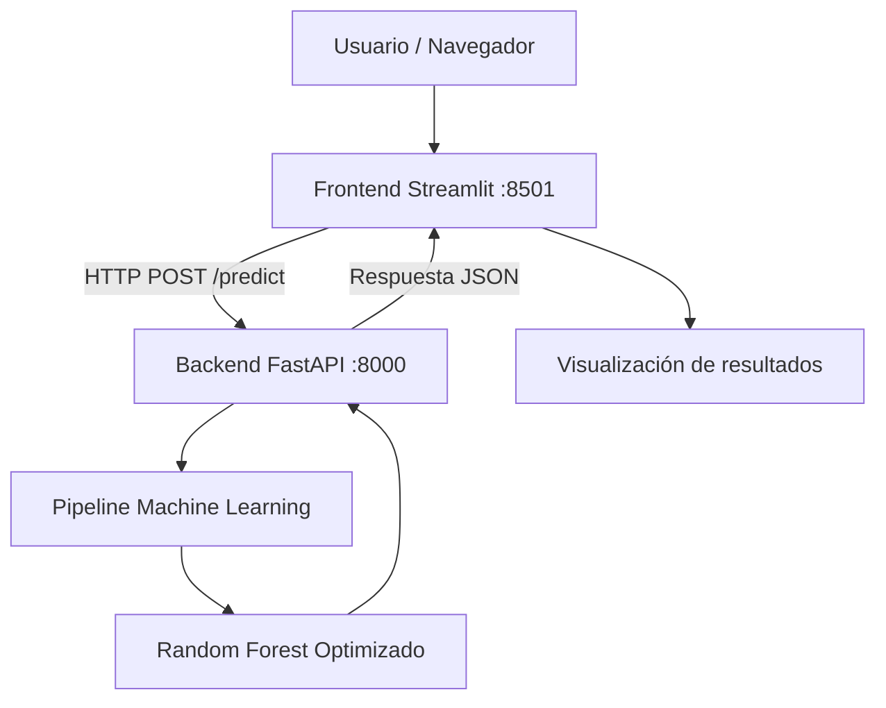

# Sentinel — Arquitectura técnica

## 1. Introducción

Sentinel es una aplicación educativa para la detección de posibles fraudes en reclamaciones de seguros de automóviles.

La solución utiliza una arquitectura basada en servicios independientes, integrados mediante una API REST y ejecutados localmente con Docker Compose.

El sistema está compuesto por:

- Frontend desarrollado con Streamlit.
- Backend desarrollado con FastAPI.
- Modelo de Machine Learning Random Forest.
- Contenedores Docker.
- Red interna administrada mediante Docker Compose.

## 2. Diagrama de arquitectura



## 3. Frontend — Streamlit

El frontend proporciona una interfaz web para capturar los datos de una reclamación de seguros.

### Funciones principales

- Mostrar un formulario con 32 variables.
- Permitir la captura y modificación de datos.
- Enviar solicitudes HTTP al backend.
- Mostrar la puntuación estimada de fraude.
- Mostrar alertas cuando se supera el umbral.
- Informar que las alertas requieren revisión humana.

**Tecnología:** Streamlit.

**Puerto:** 8501.

**Archivo principal:** `frontend/app.py`.

## 4. Backend — FastAPI

El backend recibe las solicitudes del frontend y ejecuta el modelo de Machine Learning.

### Endpoints

| Método | Endpoint | Descripción |
|---|---|---|
| GET | `/health` | Verifica el estado de la API |
| GET | `/features` | Devuelve las variables del modelo |
| POST | `/predict` | Genera una predicción de fraude |

**Tecnología:** FastAPI.

**Puerto:** 8000.

**Archivo principal:** `backend/main.py`.

## 5. Modelo de Machine Learning

Sentinel utiliza un modelo Random Forest Optimizado entrenado mediante Scikit-learn.

El entrenamiento se realizó en Google Colab utilizando el dataset público Vehicle Insurance Claim Fraud Detection de Kaggle.

### Archivos del modelo

- `sentinel_pipeline.joblib`: modelo entrenado y preprocesamiento.
- `sentinel_metadata.json`: configuración, variables y umbral de alerta.

### Configuración

| Parámetro | Valor |
|---|---|
| Modelo | Random Forest Optimizado |
| Variable objetivo | `FraudFound_P` |
| Variables predictoras | 32 |
| Umbral de alerta | 0.19 |
| Revisión humana | Obligatoria |

El modelo genera una puntuación estimada de fraude.

Si la puntuación es igual o superior a 0.19, Sentinel genera una alerta para revisión humana.

## 6. Contenerización con Docker

La aplicación utiliza dos contenedores independientes.

### Contenedor backend

Contiene:

- Python.
- FastAPI.
- Bibliotecas de Machine Learning.
- Modelo entrenado.
- Metadatos del modelo.

**Imagen:** `sentinel-backend:v1`.

**Puerto interno:** 8000.

### Contenedor frontend

Contiene:

- Python.
- Streamlit.
- Requests.
- Aplicación web.
- Reclamación de ejemplo.

**Imagen:** `sentinel-frontend:v1`.

**Puerto interno:** 8501.

## 7. Orquestación con Docker Compose

Docker Compose permite ejecutar ambos servicios mediante un único comando:

```bash
docker compose up --build -d
```

La configuración se encuentra en `compose.yaml`.

### Comunicación entre contenedores

El frontend utiliza la variable de entorno:

```text
API_URL=http://backend:8000
```

Docker Compose proporciona una red interna que permite al frontend localizar el backend mediante el nombre del servicio `backend`.

Los puertos 8000 y 8501 se publican únicamente en la interfaz local de la computadora.

## 8. Flujo de predicción

1. El usuario abre Sentinel desde el navegador.
2. Streamlit muestra el formulario de reclamación.
3. El usuario introduce los datos.
4. Streamlit envía una solicitud POST a `/predict`.
5. FastAPI valida las variables requeridas.
6. El pipeline aplica el preprocesamiento.
7. Random Forest calcula la puntuación estimada.
8. FastAPI compara la puntuación con el umbral 0.19.
9. La API devuelve la respuesta JSON.
10. Streamlit presenta el resultado al usuario.

## 9. Seguridad y limitaciones

Sentinel es un prototipo educativo y no está autorizado para producción.

Las alertas no constituyen una determinación definitiva de fraude.

La aplicación no realiza pagos, rechazos ni autorizaciones automáticas.

La versión actual no incorpora autenticación de usuarios, autorización por roles ni cifrado HTTPS en el entorno local.

El modelo tampoco cumple todas las metas de desempeño establecidas en el Business Case.

## 10. Portabilidad

La solución utiliza Docker para empaquetar sus dependencias y reducir diferencias entre entornos.

Docker Compose permite reproducir la arquitectura localmente, siempre que el equipo disponga de un motor Docker compatible y de los recursos necesarios.

El modelo se carga desde un archivo previamente entrenado, por lo que no es necesario ejecutar nuevamente el notebook de Google Colab.

## 11. Despliegue en la nube

La arquitectura podría adaptarse a servicios de contenedores administrados en la nube.

Sin embargo, el proyecto académico no contempla ejecutar dicho despliegue.

Los requisitos, configuraciones y pasos propuestos se documentarán en `docs/manual_despliegue.md`.
